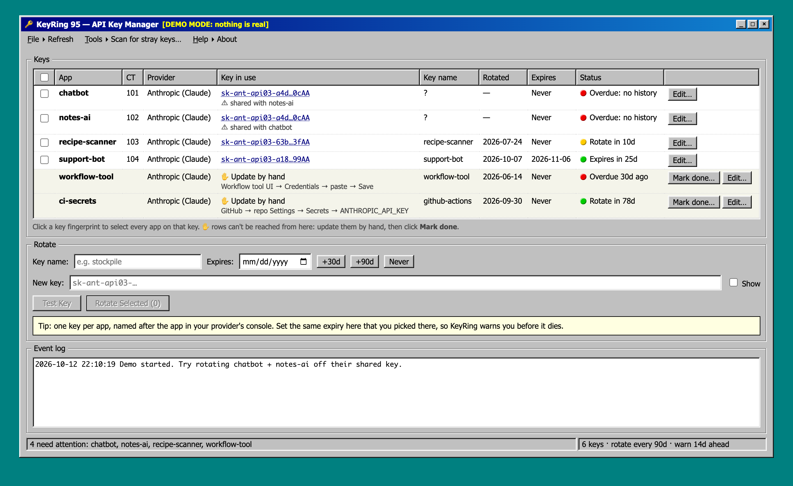

# KeyRing 95

**Find, rotate and age-track the API keys your self-hosted apps use, from one Windows 95 window.**



You run a homelab. A dozen containers each have an `ANTHROPIC_API_KEY`, an `OPENAI_API_KEY` or a Stripe key in some `.env` file. Half of them share a key, nobody remembers which key is called `test2`, and none have been rotated since you made them. KeyRing 95 fixes that:

- **Finds them.** It reads each app's key and shows its fingerprint exactly as your provider's console does (`sk-ant-api03-7gS…jgAA`), so you can match them up. Keys shared between apps get flagged. **Scan for stray keys** checks every running container, both process environments and env files on disk, for keys of [13 providers](#supported-keys) you haven't registered, and points out old keys still sitting in `.env.bak` copies.
- **Rotates them.** Paste a new key and pick the apps. For each one it tests the key with the provider, rewrites the env file in place, restarts the app and checks it came back healthy. **If the app doesn't come back, it puts the old key back.** Then it tells you which old keys nothing uses any more, so you can delete them.
- **Reminds you.** Each key is due at its expiry date or N days after rotation (default 90), whichever comes first. `GET /health` returns `503 KEYS DUE: …` two weeks ahead, and `503 DEAD: …` when a provider stops accepting a key. Point Uptime Kuma (or any monitor) at it.
- **Adds them for you.** Every untracked key in the scan has a **Track…** button. KeyRing reads the file, finds the variable, and works out how the app restarts (systemd, systemd drop-ins, docker compose or pm2). Check the guess, press OK, done. **Tools ▸ Add app…** does the same for anything else. No hand-editing `config.json`.
- **Catches dead keys.** Once a day (and on **Tools ▸ Check every key now**) it asks each provider whether each key still works. A revoked or expired key shows as **Dead key** and turns `/health` red, before your users notice.
- **Cleans up leaks.** **Tools ▸ I leaked a key…**: paste it, and KeyRing tells you whether it still works, finds every app, file and process using it, selects the tracked apps for rotation and walks you through the rest.
- **Tracks the ones it can't reach.** Keys in n8n, GitHub Actions or a laptop are listed too, marked *update by hand*, with a **Mark done** button.

It's one Python file using only the standard library, plus one HTML file. No database, no pip, no Docker.

> **v0.2.0:** Proxmox VE containers, 13 providers, track from the UI, daily live checks, leak response. More places to run are next. See the [roadmap](ROADMAP.md).

## Try it (10 seconds, no Proxmox needed)

```sh
git clone https://github.com/taylortumlin/keyring95 && cd keyring95
python3 keyring95.py demo
# open http://127.0.0.1:8099
```

Demo mode fakes six apps across three providers (two sharing a key), two hand-updated keys, and stray Groq, Stripe, GitHub and backed-up OpenAI keys for the scan. Any key of the right shape works; put `bad` in it to see the rejection.

## Install (Proxmox VE host)

```sh
git clone https://github.com/taylortumlin/keyring95 && cd keyring95
./install.sh                 # asks for a login password
nano /etc/keyring95/config.json
systemctl restart keyring95
```

Open `http://<pve-host>:8099`. Any username works; the password is the one you chose. To upgrade, run `git pull && ./install.sh`. That never touches your config or state.

### Why on the Proxmox host?

KeyRing uses `pct exec` to read and write files inside containers, and that needs the host. The host already has root over every container, so KeyRing grants nothing new. It does mean KeyRing is a sensitive service: read [Security](#security).

## Config

`/etc/keyring95/config.json` (see [`config.example.json`](config.example.json)):

| Field | |
|---|---|
| `rotate_days` | Rotate every N days (default 90) |
| `warn_days` | `/health` goes red this many days early (default 14) |
| `allow` | Client networks allowed to connect (default: private ranges + Tailscale) |
| `apps[]` | Apps KeyRing can rotate itself |
| `manual[]` | Keys you update by hand: `id`, `provider` and `where` (instructions shown in the UI) |
| `check_hours` | Ask each provider whether each key still works every N hours (default 24, `0` = off) |
| `ui_can_edit` | Let **Track** / **Add app** / **Stop tracking** write this file (default `true`). The previous version is kept as `config.json.prev` |

You rarely need to edit it by hand: **Track…** and **Add app…** write it for you.

Each app:

| Field | |
|---|---|
| `id` | Name shown in the UI |
| `provider` | One of the [supported keys](#supported-keys) below (default `anthropic`) |
| `ct` | Proxmox container ID |
| `file` | Env file holding the key |
| `var` | Variable name, e.g. `ANTHROPIC_API_KEY`. Matches `VAR=`, `export VAR=`, systemd `Environment="VAR=…"`, compose `- VAR=…` and `VAR: …`, quoted or not |
| `reload` | Shell command that makes the app pick up the new key. Optional: leave it out when nothing needs restarting |
| `check` | Shell command that exits 0 when the app is healthy (run 5s after reload). Optional |
| `note` | Optional reminder shown under the name |

Recipes for `reload`/`check`:

| App runs under | reload | check |
|---|---|---|
| systemd | `systemctl restart myapp` | `systemctl is-active myapp` |
| pm2 | `pm2 restart myapp --update-env` | `pm2 jlist \| grep -q '"status":"online"'` |
| docker compose | `cd /opt/myapp && docker compose up -d --force-recreate` | `test "$(docker inspect -f '{{.State.Running}}' myapp)" = true` |

Compose reads `env_file` when it creates the container, so a plain `docker restart` keeps the old key. Recreate it.

## Supported keys

| `provider` | Key looks like | Test call (read-only, free) |
|---|---|---|
| `anthropic` | `sk-ant-api03-…` | `GET /v1/models` |
| `openai` | `sk-proj-…`, `sk-svcacct-…` | `GET /v1/models` |
| `google` | `AIza…` (Gemini) | `GET /v1beta/models` |
| `groq` | `gsk_…` | `GET /openai/v1/models` |
| `xai` | `xai-…` | `GET /v1/models` |
| `openrouter` | `sk-or-v1-…` | `GET /api/v1/key` |
| `mistral` | 32 letters and digits (rotate only, the scan can't spot it) | `GET /v1/models` |
| `huggingface` | `hf_…` | `GET /api/whoami-v2` |
| `elevenlabs` | `sk_…` | `GET /v1/user` |
| `resend` | `re_…` | `GET /domains` (send-only keys accepted) |
| `sendgrid` | `SG.…` | `GET /v3/scopes` |
| `stripe` | `sk_live_…`, `rk_live_…` | `GET /v1/balance` (restricted keys accepted) |
| `github` | `github_pat_…`, `ghp_…` | `GET /user` |

**Help ▸ Supported keys** shows the same list in the app.

### What the scan looks at

Every running container's process environments (`/proc/*/environ`), plus env-ish files (`.env*`, `*.env`, `env`, compose files, systemd units and drop-ins, `*.conf`, `config.json`) up to four levels under `/opt`, `/srv`, `/etc`, `/var/lib`, `/root`, `/home` and `/usr/local`. Apps that load `.env` themselves (dotenv) never show the key in their environment, so the file pass catches them. Results come in three groups: **not tracked**, **only in backup copies** (old keys left in `.bak` files), and **tracked**.

## How a rotation works

1. Checks the pasted key's format and makes one cheap, authenticated call to the provider (e.g. Anthropic: `GET /v1/models`). If the key is the wrong kind, say an OpenAI key for an Anthropic app, it tells you so.
2. For each selected app: reads the env file and swaps only the key on the `VAR=` line. The write uses `cat >`, which keeps the file's owner, group and mode, and strips world-read access if it was set.
3. Runs `reload`, waits, runs `check`. If either fails, it restores the original file, reloads again and reports the failure.
4. Records the date, key name and expiry. Lists old keys no app uses any more.

## Security

- **Keys are never stored.** State holds fingerprints (first characters + last 4 + an 8-character hash) and dates only. A key passes through memory during a rotation and reaches the container through `stdin`, never a command line (`ps` can't see it). Request bodies are never logged.
- **Login** is HTTP Basic auth with a PBKDF2 password hash, and failed attempts are slowed down. Basic auth over plain HTTP is only as safe as your network, so **keep KeyRing on your LAN or VPN (e.g. Tailscale)** or put it behind a TLS reverse proxy. Clients outside `allow` get a 403.
- **The login is root-equivalent.** Anyone with it can rotate keys and, with `ui_can_edit` on, add reload commands that run as root inside your containers. Treat it like the Proxmox root password, or set `"ui_can_edit": false` and edit the config by hand.
- **Live checks** send each key to its own provider once a day, the same read-only call as **Test Key**. A network failure is recorded as unknown, never as dead.
- **`/health` needs no login** so monitors can read it. It reveals app names and nothing else.
- **Backups:** KeyRing doesn't leave `.env.bak` files. Old copies you made yourself still hold old keys. Delete those old keys at the provider and the copies are harmless.
- Found a vulnerability? See [SECURITY.md](SECURITY.md).

## Status

v0.0.1 rotated the Anthropic keys of 8 apps across 7 containers on one homelab, covering systemd, pm2 and docker compose apps. v0.1.0's scan covers 38 containers in about 10 seconds. It's small and young. Read the code (it's ~950 lines) before trusting it with production.

## Contributing

PRs welcome, especially new providers. Adding one is a regex and a test call. See [CONTRIBUTING.md](CONTRIBUTING.md).

## License

[MIT](LICENSE)
